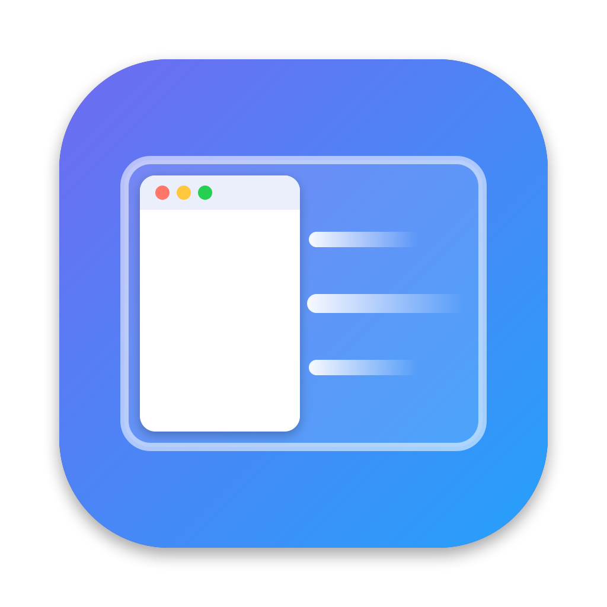

<p align="center">
  
</p>

<h1 align="center">Nudge</h1>

<p align="center">
  A tiny window snapper for macOS. Five shortcuts, no menu bar icon, nothing else.
</p>

<p align="center">
  <a href="https://github.com/SagenKoder/nudge/actions/workflows/ci.yml"></a>
  <a href="https://github.com/SagenKoder/nudge/releases/latest"></a>
  <a href="LICENSE"></a>
</p>

| Shortcut | Action |
|---|---|
| ⌃⌥ ← | Left half |
| ⌃⌥ → | Right half |
| ⌃⌥ ↑ | Top half |
| ⌃⌥ ↓ | Bottom half |
| ⌃⌥ ↩ | Maximize |

Press ⌃⌥ ← again on a window that is already on the left half, and it moves to the right half of
the screen to the left. ⌃⌥ → works the same way to the right. Windows glide into place with a short
animation.

## Install

With [Homebrew](https://brew.sh):

```sh
brew tap sagenkoder/tap
brew trust sagenkoder/tap   # Homebrew asks you to trust third-party taps once
brew install --cask nudge
```

Or download `Nudge-x.y.z.dmg` from the [latest release](https://github.com/SagenKoder/nudge/releases/latest)
and drag Nudge into Applications.

Then open Nudge. A small window asks for the **Accessibility** permission, which macOS requires
for any app that moves other apps' windows. Click **Open Accessibility Settings**, switch Nudge on,
and the window closes by itself. Nudge also adds itself to your Login Items, so it starts with your Mac.

Requires macOS 13 Ventura or later, on Apple silicon or Intel.

## Using it

- **Settings:** open Nudge again from Finder or Spotlight to show its window. It has
  "Start at login" and "Quit Nudge".
- **Shortcut conflicts:** Rectangle, Spectacle and similar apps often use the same shortcuts.
  Nudge tells you if a shortcut is taken, and picks it up as soon as the other app quits.

## Uninstall

```sh
brew uninstall --cask --zap nudge
```

Or quit Nudge from its window, drag it from Applications to the Bin, and remove it under
System Settings → Privacy & Security → Accessibility.

## Privacy and security

Nudge never connects to the internet, collects nothing, and only sees its own five key combinations.
See [SECURITY.md](SECURITY.md) for what the Accessibility permission is used for, how to verify a
download, and how to report a vulnerability.

## Building from source

```sh
git clone https://github.com/SagenKoder/nudge.git && cd nudge
swift test      # run the unit tests
make install    # build, sign and copy to /Applications, then launch
```

See [CONTRIBUTING.md](CONTRIBUTING.md) for how the code is laid out and how releases are made.

## License

[MIT](LICENSE) © 2026 Alexander Sagen
